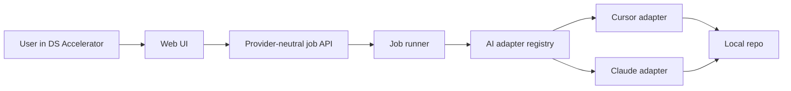

# DS Accelerator and Future AI Adapter Layer

**Audience:** a product, design, or engineering collaborator who needs to understand what the DS Accelerator is today and how it should evolve so the same accelerator can run against more than one AI tool in the future.

**Status:** current-state + forward-looking handoff. This document explains the intended direction; it does **not** mean the adapter layer is implemented yet.

---

## 1. Purpose

The **DS Accelerator** is the AI-assisted workflow inside the playground `Tools` area. Its job is to turn a design-system problem into:

1. a structured intake,
2. a short list of solution directions,
3. a guided implementation run against the repo.

Today, the implementation path is wired to the **local Cursor SDK orchestrator**. That is good enough for a local prototype, but it is too specific if the long-term goal is:

- "use this accelerator with any AI tool,"
- choose the AI provider per run,
- keep the UI stable while the execution engine changes.

This document describes how to keep the current accelerator product concept while introducing an **AI adapter layer** that can support **Cursor** and **Claude** first, and later other providers.

---

## 2. What the Accelerator Is Today

The current DS Accelerator is a three-step flow in the playground:

1. **Intake**  
   User provides ticket, Figma, component/source context, free-text instruction, and optional skills.

2. **Analysis**  
   The system generates solution directions and lets the user choose which one(s) to continue with.

3. **Implementation**  
   A long-running job edits the repo, streams progress, supports stop/retry, and returns to a success state when complete.

Current implementation surfaces:

| Surface | Current role |
| --- | --- |
| `apps/web/src/accelerator/DsAcceleratorTool.tsx` | Main UI |
| `apps/web/src/accelerator/useDsAcceleratorTool.ts` | View-model/state machine for intake, analysis, implementation |
| `apps/web/src/agentSseClient.ts` | Browser client for job start, status, cancel, and SSE stream |
| `apps/agent-orchestrator/src/server.ts` | Local Node server that creates jobs and runs Cursor agents |
| `apps/agent-orchestrator/src/index.ts` | One-shot CLI for local experiments |

Current execution model:

- The browser starts a job with `POST /api/agent/jobs`
- The orchestrator creates a server-side job
- The orchestrator starts a **Cursor** agent against the local repo
- The browser watches the job over SSE
- The UI restores the implementation screen after reload using session state + job id

This is already the right **shape** for provider-agnostic execution, because the browser is talking to a job API rather than directly to the SDK.

---

## 3. Why an AI Adapter Layer Is Needed

Right now the orchestrator is effectively both:

- a **job manager**, and
- a **Cursor-specific runtime**.

Those two concerns should be separated.

Without an adapter layer, every new provider would leak into:

- prompt-building decisions,
- endpoint behavior,
- event formatting,
- environment variables,
- capability checks,
- and UI wording.

That would make the accelerator harder to maintain and harder to trust.

The goal of the adapter layer is:

- keep one accelerator UX,
- keep one job lifecycle,
- keep one stream/event model,
- swap the underlying AI provider per run.

---

## 4. Recommended Target Architecture

The recommended direction is:



### Separation of responsibilities

| Layer | Responsibility |
| --- | --- |
| **Web UI** | Collect inputs, let user choose provider, show status/stream, remain provider-neutral |
| **Job API** | Start job, get status, stream events, cancel job |
| **Job runner** | Own job lifetime, persistence, retries, offsets, cancellation |
| **AI adapter** | Translate the normalized request into a provider-specific run |
| **Provider runtime** | Cursor SDK, Claude integration, or another future tool |

---

## 5. Recommended Adapter Contract

Another agent implementing this should introduce a small provider interface rather than branching logic across `server.ts`.

Suggested shape:

```ts
export type AiProviderId = "cursor" | "claude";

export type StartAiJobInput = {
  provider: AiProviderId;
  messages: { role: "user" | "assistant"; content: string }[];
  cwd: string;
  abortSignal?: AbortSignal;
  onEvent: (event: NormalizedAgentEvent) => void;
};

export type StartAiJobResult = {
  runId: string;
  output?: string;
  model?: string;
  status: "finished" | "error" | "cancelled";
};

export type AiProviderAdapter = {
  id: AiProviderId;
  label: string;
  supportsStreaming: boolean;
  supportsLocalRepoEdits: boolean;
  startJob(input: StartAiJobInput): Promise<StartAiJobResult>;
  cancelJob?(runId: string): Promise<void>;
  healthcheck(): Promise<Record<string, unknown>>;
};
```

Important point: the UI should never care whether the provider internally uses:

- Cursor SDK,
- Anthropic Messages API,
- Claude Code,
- or another local agent runtime.

The UI should only consume normalized job events and job status.

---

## 6. Normalize the Event Model First

The existing `AgentStreamEvent` shape in `apps/web/src/agentSseClient.ts` is already a useful base contract:

- `thinking`
- `thinking_delta`
- `thinking_done`
- `text_delta`
- `assistant`
- `tool`
- `status`
- `task`
- `error`
- `done`

That event model should become the **provider-neutral stream contract**.

Recommendation:

1. Keep the browser event contract stable.
2. Make each provider adapter translate its native events into that contract.
3. Avoid exposing provider-specific event shapes in the browser.

Examples:

- **Cursor adapter** maps SDK messages and deltas into the normalized events.
- **Claude adapter** maps Claude/Anthropic streaming output into the same event kinds.
- If Claude cannot emit a true `tool` event in the same way, emit best-effort `status` or `assistant` events instead of changing the browser protocol.

---

## 7. Provider Selection Model

The accelerator should eventually let the user choose which AI provider to use for a run.

Recommended product model:

- Default provider configured by environment or repo settings
- Optional provider picker in intake
- Provider selection stored in the run snapshot and passed into the job payload

Suggested payload extension:

```json
{
  "provider": "cursor",
  "messages": [
    { "role": "user", "content": "..." }
  ]
}
```

### Good UI behavior

- Show a simple label such as `AI: Cursor` or `AI: Claude`
- Do not expose raw SDK or API details in the main workflow
- If a provider lacks a capability, fail early with a clear message

Example capability differences to account for:

| Capability | Cursor | Claude |
| --- | --- | --- |
| Local repo editing | Strong fit today | Depends on chosen Claude runtime |
| Local Cursor rules/settings | Native | Likely indirect or unavailable |
| MCP/tool availability | Native if configured locally | Depends on adapter/runtime |
| Existing orchestrator support | Implemented | Not implemented yet |

This is why the adapter should also expose a small capability/health surface.

---

## 8. Cursor Adapter Guidance

The **Cursor adapter** should be the first extracted provider because the current implementation is already Cursor-based.

What to move behind the adapter:

- `Agent.create(...)`
- `agent.send(...)`
- model resolution/fallback
- Cursor-specific health checks
- local setting source behavior such as `CURSOR_LOCAL_SETTING_SOURCES=all`
- Cursor SDK delta-to-event translation

What should stay outside the adapter:

- job creation and ids,
- in-memory or durable job storage,
- SSE endpoint contract,
- browser reconnect logic,
- DS Accelerator prompt composition,
- session snapshot behavior.

In other words: extract provider logic without rewriting the whole product.

---

## 9. Claude Adapter Guidance

The **Claude adapter** should be designed as a peer to the Cursor adapter, not as a special case in the UI.

Before implementation, one design decision must be made:

1. **Claude via Anthropic API**
2. **Claude via Claude Code / local CLI agent**
3. **Another internal Claude runtime**

The adapter layer should absorb that decision so the rest of the system does not care.

### What the Claude adapter must answer

- Can it edit the local repo directly?
- Can it stream incremental output?
- Can it be cancelled?
- Can it access local project rules and docs automatically, or must the prompt include more explicit context?
- Can it call tools, or should the DS Accelerator treat it as a text-first provider?

### Practical recommendation

If the real goal is "same accelerator UX, different AI backend," then the Claude adapter should target the **same normalized job contract** even if its internal implementation is weaker in some areas at first.

That means a Claude MVP may initially support:

- analysis,
- streamed reasoning/output,
- implementation suggestions,

before it supports fully trusted repo-editing parity with Cursor.

The contract should support capability flags so the product can communicate these differences honestly.

---

## 10. Prompting Strategy With Multiple Providers

The prompt-building logic should remain **DS Accelerator-owned**, not provider-owned.

Keep one prompt builder for:

- intake summary,
- selected solutions,
- target component,
- sources,
- task folder,
- selected skills,
- repo guardrails,
- accessibility requirements,
- token constraints.

Then let adapters append only small provider-specific framing when needed.

Recommended split:

- **Shared prompt builder:** domain instructions for the DS repo
- **Provider adapter supplement:** tiny provider-specific preface, if required

This prevents drift where Cursor gets one workflow and Claude gets a completely different one.

---

## 11. Suggested Refactor Sequence

Another agent working on this should take the change in small steps:

1. **Extract a provider-neutral job runner**
   - Keep existing endpoints
   - Move Cursor-specific run code out of `server.ts`

2. **Introduce adapter types and a provider registry**
   - `cursor` only at first
   - No UI changes yet

3. **Add `provider` to job creation payload**
   - Default to `cursor`
   - Preserve backward compatibility if omitted

4. **Add a simple provider selector in DS Accelerator intake**
   - Start with `Cursor` and `Claude`
   - Disable unsupported options with clear copy if needed

5. **Implement Claude adapter**
   - Map its stream into normalized events
   - Return capability metadata

6. **Add provider-aware health reporting**
   - surface configured providers
   - show missing credentials clearly

7. **Only then add provider-specific UX details**
   - warnings,
   - capability differences,
   - default provider selection.

This sequence keeps the current working Cursor path intact while opening the door to Claude.

---

## 12. Suggested File Direction

These are suggested future files, not current guaranteed paths:

| Proposed file | Role |
| --- | --- |
| `apps/agent-orchestrator/src/adapters/types.ts` | Shared adapter types |
| `apps/agent-orchestrator/src/adapters/cursorAdapter.ts` | Cursor implementation |
| `apps/agent-orchestrator/src/adapters/claudeAdapter.ts` | Claude implementation |
| `apps/agent-orchestrator/src/adapters/providerRegistry.ts` | Select adapter by provider id |
| `apps/agent-orchestrator/src/jobs/jobRunner.ts` | Provider-neutral job execution |
| `apps/agent-orchestrator/src/jobs/jobStore.ts` | Job storage abstraction |
| `apps/agent-orchestrator/src/events/normalizedEvents.ts` | Shared event model |

The important thing is not the exact filenames. The important thing is separating:

- provider logic,
- job logic,
- API logic,
- and product/UI logic.

---

## 13. Risks to Avoid

### 13.1 Provider logic leaking into the browser

Do not make the browser understand Cursor SDK objects or Claude-native event formats.

### 13.2 Duplicated prompt builders

Do not fork prompt composition per provider unless absolutely necessary.

### 13.3 Fake parity

If Cursor can edit the repo but Claude can only propose diffs at first, say so clearly. Do not imply equal capability before it exists.

### 13.4 Browser-owned job lifetime

Keep the current lesson from the existing orchestrator: long-running work must belong to a server-side job, not to the browser tab.

### 13.5 Hidden credential assumptions

Each provider should have explicit config requirements and health reporting.

---

## 14. Success Criteria for the Adapter Direction

This transformation is successful when:

- the DS Accelerator UI still feels like one product,
- the implementation job API stays stable,
- provider selection is explicit but simple,
- `Cursor` remains the trusted local editing path,
- `Claude` can be integrated without rewriting the accelerator,
- browser reload recovery still works,
- provider capability differences are surfaced honestly,
- and future providers can be added by implementing one adapter contract.

---

## 15. Short Version for the Next Agent

If you are the next agent touching this:

1. Do **not** rewrite the accelerator UI first.
2. Extract the **Cursor-specific execution code** out of `apps/agent-orchestrator/src/server.ts`.
3. Keep the current SSE/job protocol as the stable product contract.
4. Add a provider-neutral adapter interface.
5. Make `cursor` the first adapter implementation.
6. Add `claude` as a second adapter behind the same contract.
7. Only then expose provider selection in the intake UX.

That path gives the repo a clean migration from "DS Accelerator powered by Cursor" to "DS Accelerator powered by a selectable AI runtime."
