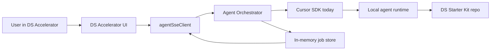
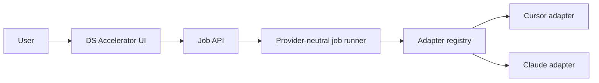

# Phase 7 - DS Accelerator Orchestration and Future Multi-AI Direction

**Audience:** product, design, and engineering collaborators who need to understand what the DS Accelerator is, why the current orchestrator exists, what architecture lessons were already learned, and how this work should evolve toward a provider-selectable AI model.

**Adapted from:** the FSB `phase-7.md` document, rewritten for the neutral **DS Starter Kit** context.

**Prerequisites:** `README.md`, `docs/project-intent.md`, and `docs/ds-accelerator-ai-adapter-handoff.md`.

---

## Document Control

| Field | Value |
| --- | --- |
| **What this phase covers** | DS Accelerator product concept, local job orchestration, browser-to-agent streaming, implementation recovery, mock mode, current Cursor-based runtime, and the architectural path toward an AI adapter layer. |
| **What this phase does not cover** | Production deployment, enterprise auth, durable storage, cloud workers, provider billing controls, or a fully implemented multi-provider runtime. |
| **Primary PoC surface** | `apps/web/src/accelerator/`, `apps/web/src/agentSseClient.ts`, `apps/agent-orchestrator/`, and the Tools route in `apps/web/src/App.tsx`. |
| **Current status** | Working local prototype. Useful for demos, UI iteration, and local experimentation. Not yet hardened as a production workflow and not yet provider-agnostic. |

---

## 1. Executive Summary

Phase 7 brings the DS Starter Kit from "a design-system playground with components and tokens" to "a playground that can also run an AI-assisted design-system workflow."

The main output is the **DS Accelerator**:

1. **Intake** - the user provides ticket, component/design context, instructions, and optional skills.
2. **Analysis** - the system proposes solution directions.
3. **Implementation** - the selected solution is applied through a long-running orchestrated agent job.

Today, the implementation runtime is **Cursor-based**. That is acceptable for the prototype because it proves the important product and architecture ideas:

- a design-system user can start work from structured UI,
- the browser can watch long-running work safely,
- the implementation step can survive reloads,
- mock mode can support UI iteration without spending AI budget.

The next structural step is not "replace Cursor." It is:

**keep the accelerator workflow, but introduce an adapter layer so the same job system can run against different AI providers, starting with Cursor and Claude.**

---

## 2. Why This Phase Exists

The DS Starter Kit is meant to be approachable for designers and non-developers, not just engineers.

That means the AI-assisted workflow cannot depend on a user manually:

- opening a terminal,
- composing a long prompt,
- remembering repo guardrails,
- or understanding SDK internals.

The accelerator exists to provide:

- a structured place to describe the problem,
- visible solution alternatives,
- a clearer transition from idea to implementation,
- and an implementation job the user can watch, stop, and confirm.

This phase is therefore both:

- a **product UX phase**, and
- an **orchestration architecture phase**.

---

## 3. Product Concept

The DS Accelerator is a **problem -> solution options -> implementation** workflow inside `Tools`.

### 3.1 What the user provides

The user can provide:

- a task or ticket reference,
- a component source or other repo context,
- an optional Figma link,
- a plain-language instruction,
- optional accelerator skills,
- mock mode for UI-only testing.

### 3.2 What the tool produces

The tool produces:

- a structured interpretation of the request,
- a short list of solution directions,
- a preview of the current component,
- a preview of the selected solution direction,
- a live thought/activity stream,
- implementation progress and completion state.

### 3.3 Intended mental model

The intended user mental model is:

1. I describe the problem.
2. The accelerator proposes solutions.
3. I choose a direction.
4. The accelerator starts implementation.
5. I can watch, stop, retry, and confirm.

The user should not need to understand SDK calls, event offsets, or server reconnect behavior.

---

## 4. Repository Surfaces

### 4.1 Web app

| File / area | Role |
| --- | --- |
| `apps/web/src/accelerator/DsAcceleratorTool.tsx` | Main accelerator UI |
| `apps/web/src/accelerator/useDsAcceleratorTool.ts` | State machine, analysis flow, implementation flow, session persistence |
| `apps/web/src/accelerator/DsAcceleratorTool.css` | Accelerator layout and styling |
| `apps/web/src/accelerator/ComponentPreview.tsx` | Baseline component preview surface |
| `apps/web/src/agentSseClient.ts` | Browser helper for chat/job requests, status checks, cancellation, and stream watching |
| `apps/web/src/components/custom/AiTask.tsx` | Task/solution cards |
| `apps/web/src/components/custom/AiAgentInput.tsx` | Intake prompt UI |
| `apps/web/src/components/custom/AiAttachment.tsx` | Source attachment UI |
| `apps/web/src/App.tsx` | Playground route / tool entry point |

### 4.2 Orchestrator

| File / area | Role |
| --- | --- |
| `apps/agent-orchestrator/src/server.ts` | Local HTTP + SSE server for agent-backed runs |
| `apps/agent-orchestrator/src/index.ts` | One-shot CLI runner |
| `apps/agent-orchestrator/src/stream-format.ts` | SDK message to browser event mapping |
| `apps/agent-orchestrator/src/delta-stream-format.ts` | Delta-to-event mapping |
| `apps/agent-orchestrator/README.md` | Setup and endpoint summary |

### 4.3 Supporting docs

| File / area | Role |
| --- | --- |
| `docs/tasks/*/` | Example tasks and solution documentation |
| `.cursor/skills/*/SKILL.md` | Optional skills selectable in the accelerator |
| `docs/ds-accelerator-ai-adapter-handoff.md` | Future adapter-layer handoff for provider selection |

---

## 5. Current Runtime: Cursor First

The current orchestrator uses the **Cursor TypeScript SDK**.

It currently:

- starts local agents against the repo root,
- streams activity back to the browser,
- stores job events in memory,
- allows cancellation,
- supports reconnect after reload through job id + event offset,
- and respects local Cursor settings when configured.

This gives the DS Accelerator a real implementation path today.

It is also intentionally local-first:

- local API key,
- local repo checkout,
- local settings,
- local dev server proxy,
- local experimentation.

This is fine for a prototype, but it is one provider-specific runtime inside a broader product concept.

---

## 6. Architecture

Current responsibilities:

- **Web UI** collects context, shows solutions, starts jobs, restores state after reload.
- **SSE client** provides typed browser helpers.
- **Server** owns the job lifetime.
- **Cursor runtime** executes the actual work.
- **Job store** preserves events while the server stays alive.

This shape should be preserved even when more AI providers are added.

---

## 7. Endpoint Contract

The local orchestrator exposes:

| Endpoint | Purpose |
| --- | --- |
| `GET /api/agent/health` | Report current runtime health |
| `POST /api/agent/chat` | Blocking one-shot prompt |
| `POST /api/agent/chat/stream` | Older streaming-in-one-request flow |
| `POST /api/agent/jobs` | Start a persistent job and return `jobId` |
| `GET /api/agent/jobs/:jobId` | Get current job status and result |
| `GET /api/agent/jobs/:jobId/stream?after=N` | Watch and replay job events |
| `POST /api/agent/jobs/:jobId/cancel` | Request cancellation |

The **job endpoints** are the strategic foundation. They are the right abstraction to keep when introducing multiple AI providers.

---

## 8. Event Model

The browser currently consumes normalized events such as:

- `thinking`
- `thinking_delta`
- `thinking_done`
- `text_delta`
- `assistant`
- `tool`
- `status`
- `task`
- `error`
- `done`

This event contract should be treated as a **stable product surface**.

Future provider adapters should translate their native event streams into this contract rather than changing the browser protocol for each provider.

---

## 9. The Key Lesson Already Learned

The most important architecture lesson from the prototype is:

**Do not couple implementation lifetime to browser lifetime.**

The earlier "start and stream in one request" model is too fragile for long-running work. Browser reloads, dev-server reconnects, route changes, or stream interruptions can happen even when the underlying work should continue.

The corrected shape is:

1. browser starts a job,
2. server owns the job,
3. browser watches the job,
4. browser can reconnect safely.

That lesson remains true whether the runtime is Cursor, Claude, or anything else.

---

## 10. Job Lifecycle

### 10.1 Start

The browser starts a job through `POST /api/agent/jobs`.

The server:

- creates a job id,
- stores queued state,
- starts work in the background,
- returns the id immediately.

### 10.2 Run

The runtime executes the implementation job and emits normalized events.

### 10.3 Watch

The browser subscribes to `/stream?after=N` so it can reconnect without replaying everything.

### 10.4 Reconnect

If the watcher drops, the browser checks status and reconnects without cancelling the underlying work.

### 10.5 Finish

When the job finishes, the UI moves to implementation-ready / success behavior and surfaces changed files when available.

### 10.6 Cancel

`Stop Implementation` is explicit user intent. It should cancel the job when the provider/runtime supports cancellation.

---

## 11. Browser Session Recovery

The accelerator stores a compact session snapshot so the implementation screen can recover after reload.

That snapshot concept should remain provider-neutral. It should store:

- current accelerator state,
- selected solution,
- stream items,
- implementation task statuses,
- active job id,
- stream offset,
- relevant error state,
- selected provider once provider selection exists.

The browser should restore the UI first, then ask the server whether the job is still alive.

---

## 12. Mock Data Test

Mock mode is first-class product infrastructure, not a temporary trick.

It exists so teams can work on:

- layout,
- copy,
- solution-card behavior,
- implementation-step UX,
- scroll behavior,
- retry/confirm behavior,
- demo rehearsal,

without spending AI tokens or depending on a live provider.

Mock mode should remain available even after the adapter layer exists.

---

## 13. What Changes for a Multi-AI Future

The next step is not a new accelerator. It is a new **runtime boundary**.

Today:

- the server owns jobs,
- the server also contains Cursor-specific execution logic.

Target future:

- the server still owns jobs,
- provider-specific execution moves into adapters,
- the UI chooses a provider,
- the job API stays the same.

Recommended target model:

This change should happen in the orchestrator first, not in the UI first.

---

## 14. Cursor and Claude in This Context

### Cursor

Cursor is the existing, strongest fit for the current prototype because it already supports:

- local repo-aware agent runs,
- local settings,
- streamed output,
- and the current orchestrator implementation.

### Claude

Claude is a desired future peer provider, but its adapter design needs one decision first:

- direct Anthropic API,
- Claude Code / CLI runtime,
- or another internal Claude execution path.

The DS Accelerator should not expose that choice in its main UX. The adapter layer should hide it.

### Product implication

The product should eventually let the user pick:

- `Cursor`
- `Claude`

while the system honestly communicates capability differences.

Example: if Cursor can edit the repo directly but Claude initially only supports proposal-quality output, the UI must say that clearly rather than pretending the providers are identical.

---

## 15. Recommended Refactor Direction

Another agent picking up this work should follow this order:

1. Extract Cursor-specific execution from `apps/agent-orchestrator/src/server.ts`
2. Introduce a provider-neutral adapter interface
3. Keep the current job + SSE contract stable
4. Register `cursor` as the first adapter
5. Add `provider` to the job request payload
6. Add a basic provider selector to the accelerator intake
7. Implement `claude` behind the same adapter contract
8. Add provider-aware health/capability reporting

This preserves working behavior while opening the door to a multi-provider future.

---

## 16. Known Risks

| Risk | Why it matters | Current / recommended mitigation |
| --- | --- | --- |
| In-memory job store | Jobs disappear if the server restarts | Accept for local PoC; use durable storage later |
| Cursor-specific execution inside `server.ts` | Hard to add providers cleanly | Extract adapter layer before expanding UI |
| Provider capability mismatch | One provider may not support local editing parity | Add capability flags and honest UX copy |
| Event-model drift | Different providers emit different stream shapes | Keep one normalized browser event contract |
| Prompt drift by provider | Different prompts make the product inconsistent | Keep one shared DS prompt builder |
| Local credentials | Keys remain local and sensitive | Keep `.env` local; never commit credentials |
| Over-promising "any AI" too early | Product trust drops if unsupported providers are selectable | Add provider selection only when each option has a meaningful adapter path |

---

## 17. Success Criteria

This phase is successful when:

- a user can understand the accelerator flow without reading code,
- mock mode supports layout and product iteration,
- implementation is resilient to browser reloads,
- the stream makes work visible,
- stop/retry/confirm behavior is clear,
- Cursor-backed local implementation remains usable,
- and the architecture is ready to add a provider-neutral adapter layer without replacing the whole accelerator.

---

## 18. What Is Still Missing Before Production

Before this becomes a production-grade workflow, the team still needs:

- durable job storage,
- authentication and authorization,
- audit logging,
- structured changed-file output,
- better failure taxonomy,
- provider-aware credential validation,
- stronger cancellation guarantees,
- tests around job status transitions and reconnect behavior,
- and a real adapter implementation for additional providers.

---

## 19. Practical Lessons

### 19.1 Keep the browser as viewer/controller

The browser should start, watch, and cancel jobs. It should not be the thing that keeps the work alive.

### 19.2 Treat mock mode as product infrastructure

AI-backed UI is too expensive to tune if every layout iteration requires a real model run.

### 19.3 Normalize events once

Provider-specific stream formats should be translated on the server side.

### 19.4 Keep prompts domain-owned

The DS Accelerator should own the design-system instructions. Providers should only adapt execution details.

### 19.5 Introduce providers through an adapter, not conditionals everywhere

If `Cursor` and `Claude` are added through scattered branching logic, the codebase will become hard to trust and harder to extend.

---

## 20. Recommended Next Phase

The next phase after this should be:

**extract the provider-neutral orchestration layer while preserving the current working Cursor path.**

That means:

1. formalize the adapter contract,
2. move Cursor into the first adapter,
3. add provider selection plumbing,
4. implement the first Claude adapter path,
5. keep the DS Accelerator UX stable throughout.

This keeps the repo moving toward "usable with more than one AI tool" without losing the current local prototype value.
